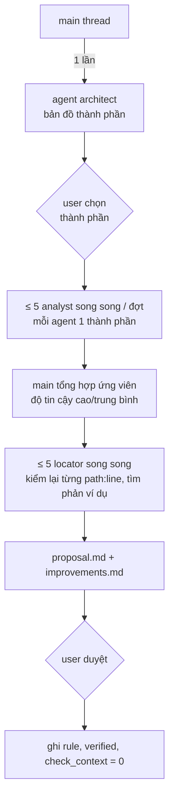

# codebase-memory

Bộ nhớ dài hạn về codebase cho Claude Code. Mỗi phiên Claude Code mới không nhớ gì về repo: convention, kiến trúc, lý do của các quyết định, những lỗi từng bị sửa. Plugin giữ tri thức đó **trong chính các file của repo** (commit được, team dùng chung, Codex cũng đọc được), chỉ nạp phần cần **đúng lúc cần**, và **tự kiểm** tri thức đó còn khớp code hay không.

## Nguyên tắc

- **Chỉ ghi điều không suy ra được từ code**: lý do, bẫy runtime, quyết định, điều Claude đã làm sai, convention trải trên nhiều file (kèm số liệu N/M). Không ghi cây thư mục, danh sách class, kiến thức framework phổ thông. Docs do LLM tự sinh hàng loạt làm AI làm việc *tệ hơn* (ETH Zurich, arXiv 2602.11988).
- **Mỗi điều có bằng chứng** `path:line` trong file đã được git track.
- **Máy kiểm, người duyệt**: script tất định phát hiện docs lệch code; mọi thay đổi file context đều là đề xuất, user duyệt rồi mới ghi. Plugin không bao giờ commit.

## Cài đặt

Yêu cầu: Claude Code có hỗ trợ plugin, `git`, `python3` (chỉ dùng stdlib).

```bash
claude plugin marketplace add NguyenThanhHungDev140503/codebase-memory   # marketplace "hung-plugins"
claude plugin install codebase-memory@hung-plugins                       # scope user: áp dụng mọi repo
```

Phát triển cục bộ: clone repo rồi `claude plugin marketplace add <thư mục clone>` thay cho dòng đầu.

Mở phiên mới để hook, skill, agent có hiệu lực. Kiểm: `claude plugin details codebase-memory@hung-plugins`.

Cập nhật sau khi sửa mã nguồn plugin (Claude Code chạy bản copy trong plugin cache, không chạy thư mục nguồn):

```bash
claude plugin marketplace update hung-plugins
claude plugin update codebase-memory@hung-plugins                 # rồi mở phiên mới
```

## Tri thức nằm ở đâu (trong repo của bạn)

| File | Nạp khi nào | Chứa gì |
|---|---|---|
| `AGENTS.md` | mọi phiên (qua `@AGENTS.md`); Codex đọc trực tiếp | lệnh build/test, kiến trúc vài dòng, luật cứng toàn repo, bảng "sửa vùng nào → đọc rule nào" |
| `CLAUDE.md` | mọi phiên | `@AGENTS.md` + vài dòng riêng cho Claude |
| `.claude/rules/<vùng>.md` | **tự động** khi Claude đọc/sửa file khớp `paths:` | convention, anti-pattern, bẫy của một vùng code |
| `docs/claude-reference/*.md` | khi rule trỏ tới | chi tiết dài |
| `docs/adr/NNNN-*.md` | khi rule/`AGENTS.md` trỏ tới | quyết định + phương án đã loại (để Claude không đề xuất lại) |
| `CONTEXT.md` | khi cần | thuật ngữ nghiệp vụ |
| auto-memory / `~/.claude/CLAUDE.md` | mọi phiên | sở thích cá nhân của user — KHÔNG ghi vào repo |

Phần luôn nạp giữ nhỏ (mục tiêu < 3k token); chi tiết nằm ở rule theo vùng. Ví dụ một repo .NET ~2.400 file C#: ~4k → ~1.2k token mỗi phiên.

## Thành phần

| Thành phần | Kích hoạt | Làm gì |
|---|---|---|
| Hook **SessionStart** | tự động khi mở/resume phiên | `check_context.py --session-start`: im lặng nếu context khớp code, lệch thì in ≤ 5 dòng cảnh báo |
| Hook **Stop** | tự động cuối mỗi lượt (chỉ repo đã có rule `paths:`) | `stop_capture.py`: tin cuối của user có dạng sửa sai/dạy lại → nhắc Claude đề xuất `learn-new`, tối đa 1 lần/phiên |
| `/codebase-memory:bootstrap` | user gõ, 1 lần/repo | dựng bộ context từ docs cũ + lịch sử chat + git log |
| `/codebase-memory:analyze [thành phần] [--deep]` | user gõ, sau bootstrap hoặc khi rule còn mỏng | phân tích CODE bằng agent → rule có số liệu N/M |
| `/codebase-memory:learn-new <bài học>` | Claude tự đề xuất, hoặc user gõ | ghi 1 bài học vào đúng file |
| `/codebase-memory:audit [--metrics-only]` | user gõ khi hook cảnh báo / sau refactor / hằng tháng | sửa mục lỗi thời, in thước đo |
| `/codebase-memory:guide [câu hỏi]` | user hỏi | giải thích plugin, chẩn đoán repo, gợi ý bước tiếp theo |
| agent `architect` (opus) | analyze/bootstrap gọi | bản đồ kiến trúc hiện có: thành phần, glob, file then chốt, luồng request |
| agent `analyst` (sonnet; `--deep` → opus) | analyze gọi, 1 agent/thành phần | quét toàn bộ file một thành phần → ứng viên luật (N/M, ví dụ, phản ví dụ) |
| agent `locator` (sonnet) | analyze/learn-new/audit gọi | tìm định nghĩa/chỗ dùng, trả `path:line` (ưu tiên LSP, thiếu thì grep) |
| `scripts/check_context.py` | hook/skill gọi, chạy tay được | kiểm docs khớp code; đo token |
| `scripts/mine_history.py` | skill gọi, chạy tay được | trích những lần user sửa/dạy lại Claude từ transcript |

`bootstrap`, `analyze`, `audit` đặt `disable-model-invocation: true`: chỉ user gõ được, Claude không tự chạy.

## Luồng hoạt động

### Vòng đời

```mermaid
flowchart LR
    A[Repo mới] -->|/bootstrap| B[AGENTS.md + CLAUDE.md<br/>+ .claude/rules + ADR]
    B -->|/analyze| C[Rule có số liệu N/M<br/>từ phân tích code]
    C --> D[Làm việc hằng ngày]
    D -->|Claude chạm file| E[Rule theo paths tự nạp]
    D -->|user sửa sai| F[Hook Stop nhắc → /learn-new]
    F --> C
    D -->|mở phiên| G[Hook SessionStart kiểm lệch]
    G -->|lệch| H[/audit]
    H --> C
```

### Mở phiên: hook SessionStart

1. Tìm git root (không phải repo → im lặng).
2. Cache theo `HEAD` + mtime/size của các file docs (`.git/codebase-memory.cache`): không đổi → in lại kết quả cũ (~0.07s).
3. Đổi → quét `CLAUDE.md`, `AGENTS.md`, `CONTEXT.md`, `.claude/rules/**`, `docs/adr/*`, `docs/claude-reference/*`; trong mỗi `` `inline code` `` (bỏ code block và dòng có `<!-- ctx-ignore`):
   - đường dẫn (`a/b.cs`, `a/b/`) phải tồn tại **và** nằm trong git (gitignored/untracked → báo, vì người khác clone sẽ không có);
   - `a/b.cs:42` → file phải đủ 42 dòng;
   - tên dạng PascalCase (`IWriteUnitOfWork`) phải có trong code;
   - rule có `paths:` → mỗi glob khớp ≥ 1 file; có `verified: <sha>` → báo nếu code trong các glob đã đổi kể từ sha.
4. In ≤ 5 dòng (0 lỗi thì không in gì). Lỗi nội bộ không bao giờ làm hỏng việc mở phiên.

### Cuối mỗi lượt: hook Stop

1. Bỏ qua nếu: `CODEBASE_MEMORY_STOP_CAPTURE=0`, đang trong vòng lặp hook (`stop_hook_active`), không phải git repo, repo chưa có rule `paths:`, đã nhắc trong phiên này, phiên headless (`claude -p`).
2. Đọc tin nhắn cuối của user trong transcript; khớp mẫu sửa sai ("không phải", "đừng", "lần sau", "KHÔNG" viết hoa, …; cùng regex với `mine_history.py`) → chặn kết thúc lượt, yêu cầu Claude xét: là bài học về codebase chưa có trong rule thì đề xuất `/codebase-memory:learn-new` (chờ user duyệt); chỉ là làm rõ yêu cầu thì bỏ qua.
3. Ghi cờ `.git/codebase-memory/stop-<session_id>` để không nhắc lại trong phiên.

### `/codebase-memory:bootstrap`

1. **Khảo sát**: context sẵn có, stack (đuôi file), vùng code, lệnh build/test thật. Repo đã có rule `paths:` → dừng, gợi ý `analyze`/`audit`/`learn-new`.
2. **Gom ứng viên**: tách `CLAUDE.md`/`AGENTS.md` cũ thành từng mục và kiểm bằng `check_context`; `mine_history.py` (ghi ra ngoài repo vì transcript có thể chứa secret); `git log` tìm lỗi lặp lại.
3. **Cổng nạp** cho mọi mục: đáng nhớ · có bằng chứng trong file đã track · máy hóa được thì gợi ý test.
4. **Đề xuất**: `AGENTS.md` ≤ 120 dòng, `CLAUDE.md` ≤ 20 dòng, ≤ 12 rule × ≤ 40 dòng, ADR/`CONTEXT.md` khi có. Mỗi mục docs cũ phải có đích hoặc lý do bỏ.
5. **Duyệt → ghi** → `verified` = HEAD → `check_context --full` = 0 lỗi → báo token trước/sau.

### `/codebase-memory:analyze`



Kết quả trung gian ghi vào `.git/codebase-memory/analysis/<ngày>-<sha>/` (không bao giờ bị commit, phiên sau dùng lại được). Agent chạy trong phiên bằng tool Agent để user theo dõi, không qua `claude -p`.

### `/codebase-memory:learn-new`

Phân loại → đích (rule theo vùng / luật cứng `AGENTS.md` / ADR / `CONTEXT.md` / auto-memory nếu là sở thích cá nhân) → tìm chỗ đã có (trùng thì dừng, mâu thuẫn thì hỏi) → `locator` tìm bằng chứng → viết 1 dòng → trình diff → duyệt → ghi + `verified` + `check_context`.

### `/codebase-memory:audit`

`check_context --full` + `--metrics` + `mine_history --count` → chẩn đoán từng finding (đổi tên/xóa file qua `git log -M`, `git log -S` cho tên type, đọc diff từ `verified` cho rule) → MỘT bản tổng hợp cũ → mới kèm bằng chứng → duyệt → ghi → kiểm lại tới 0 lỗi → báo thước đo.

## Hướng dẫn sử dụng

**1. Lần đầu trong một repo**

```text
/codebase-memory:bootstrap          # duyệt đề xuất
/codebase-memory:analyze            # tùy chọn: rule chi tiết từ code (tốn nhiều agent; chọn thành phần ở bước 1)
```

Rồi tự commit cùng lúc `AGENTS.md`, `CLAUDE.md`, `.claude/rules/`, `docs/adr/`… (hook sẽ báo "chưa được track" nếu docs trỏ tới file chưa commit).

**2. Hằng ngày**: không cần làm gì. Rule tự nạp theo vùng code; hook chỉ lên tiếng khi context lệch.

**3. Khi sửa Claude / giải thích convention**: hook Stop nhắc Claude đề xuất; hoặc tự gõ:

```text
/codebase-memory:learn-new QueryHandler không được inject IWriteUnitOfWork, dùng IReadRepository
```

**4. Khi hook SessionStart cảnh báo, sau refactor lớn, hoặc hằng tháng**

```text
/codebase-memory:audit
```

**5. Không biết làm gì tiếp**

```text
/codebase-memory:guide bước tiếp theo là gì?
```

### Chạy script bằng tay

```bash
S=<thư mục clone>/codebase-memory/scripts   # hoặc bản trong plugin cache: ~/.claude/plugins/cache/hung-plugins/codebase-memory/<version>/scripts
python3 $S/check_context.py --full       # liệt kê lỗi file:line, exit 1 nếu có
python3 $S/check_context.py --metrics    # token luôn nạp + số commit kể từ verified của từng rule
python3 $S/mine_history.py --count       # tỉ lệ tin nhắn sửa sai theo tuần ISO (giảm dần = Claude đang "học")
python3 $S/mine_history.py --since 2026-11-01 --out /tmp/lessons.md   # ứng viên bài học, đã che secret
```

`mine_history.py` đọc `${CLAUDE_CONFIG_DIR:-~/.claude}/projects/<repo mã hóa>*/*.jsonl` (gộp worktree cùng tiền tố, bỏ subagent, bỏ phiên headless, bỏ trùng do resume/fork). Không ghi gì vào repo.

## Định dạng rule

```markdown
---
paths: ["Application/Features/**", "Domain/SeedWork/**"]
verified: 14ad7e48
---
# CQRS: read vs write

- QueryHandler inject `IReadRepository<T>` trực tiếp, KHÔNG qua UnitOfWork — read đi connection replica. Đúng: `<path>:<line>`
- KHÔNG tự trim chuỗi trong handler vì `TrimStringBehavior` đã trim cho mọi request (N/M handler tuân thủ). Đúng: `<path>:<line>`
```

- `paths`: glob (cú pháp git pathspec), rule chỉ nạp khi Claude đọc/sửa file khớp.
- `verified`: commit lúc rule được đối chiếu với code lần cuối; sửa rule thì cập nhật `git rev-parse --short HEAD`.
- Mỗi dòng: mệnh lệnh + lý do + bằng chứng. Chi tiết dài → `docs/claude-reference/`.

## Cấu hình

| Thiết lập | Cách đặt | Tác dụng |
|---|---|---|
| Tắt hook Stop | `"env": { "CODEBASE_MEMORY_STOP_CAPTURE": "0" }` trong `~/.claude/settings.json` | không nhắc `learn-new` nữa |
| Bỏ qua 1 dòng khi kiểm | thêm `<!-- ctx-ignore -->` (có thể kèm lý do: `<!-- ctx-ignore: file sinh tự động -->`) cuối dòng | dùng cho tên thuộc thư viện ngoài, hệ thống khác, file sinh tự động |
| Tắt cả plugin | `claude plugin disable codebase-memory@hung-plugins` | |

## Xử lý sự cố

| Triệu chứng | Nguyên nhân / cách xử lý |
|---|---|
| Rule không được nạp | rule chỉ nạp khi Claude Read/Edit file khớp `paths` (lúc lập kế hoạch thì đọc theo bảng trong `AGENTS.md`); glob sai → `check_context --full` báo "glob không khớp file nào" |
| Hook im lặng | 0 lỗi (cache theo HEAD + docs). Xóa `.git/codebase-memory.cache` để ép kiểm lại |
| Báo nhầm tên type | tên thuộc thư viện ngoài / hệ thống khác → `<!-- ctx-ignore -->` |
| "chưa được track" | docs trỏ tới file chưa commit: commit cùng docs, hoặc bỏ tham chiếu nếu file chỉ giữ local |
| "bị gitignore" | người khác không có file đó: bỏ tham chiếu (file sinh tự động thì `ctx-ignore`) |
| "N file trong paths đã đổi từ verified" | code vùng đó đã đổi: chạy `/codebase-memory:audit` để đối chiếu rồi nâng `verified` |
| Hook Stop nhắc nhầm | câu chỉ là làm rõ yêu cầu: Claude tự bỏ qua; tối đa 1 lần/phiên; tắt bằng env ở trên |
| Sửa mã nguồn plugin không thấy tác dụng | chạy 2 lệnh cập nhật ở mục Cài đặt rồi mở phiên mới |
| Agent của plugin chưa có (vừa cài) | skill tự dùng `general-purpose` với nội dung `agents/<tên>.md`; mở phiên mới để có agent thật |

## Phát triển plugin

```text
codebase-memory/
├── .claude-plugin/plugin.json
├── hooks/hooks.json            # SessionStart → check_context.py, Stop → stop_capture.py
├── scripts/                    # stdlib Python, tất định
│   ├── check_context.py
│   ├── mine_history.py
│   └── stop_capture.py
├── skills/{bootstrap,analyze,learn-new,audit,guide}/SKILL.md
├── agents/{architect,analyst,locator}.md
└── tests/                      # unittest, tự dựng git repo/transcript tạm
```

```bash
cd <thư mục clone>/codebase-memory
python3 -m unittest discover -s tests          # chạy toàn bộ test
claude plugin validate .                       # kiểm manifest
```

Đổi phiên bản trong `plugin.json` mỗi lần sửa, rồi chạy 2 lệnh cập nhật ở mục Cài đặt.

## Giới hạn đã biết

- Token luôn nạp là ước lượng (ký tự / 3), không phải đếm token thật.
- Kiểm tên type chỉ bắt PascalCase ghép; tên có dấu chấm (`OrderService.Place`) chỉ được `audit` bắt khi đọc diff.
- Regex sửa sai (hook Stop, `mine_history`) còn bắt cả câu làm rõ yêu cầu; thước đo `--count` chỉ có ý nghĩa khi so xu hướng nhiều tuần.
- Transcript Claude Code chỉ giữ một khoảng thời gian; bài học cũ hơn đã mất thì không khai thác được.
- Hook Stop chạy song song với các hook Stop khác (vd review gate của Codex); trường hợp cả hai cùng chặn chưa được thử.
